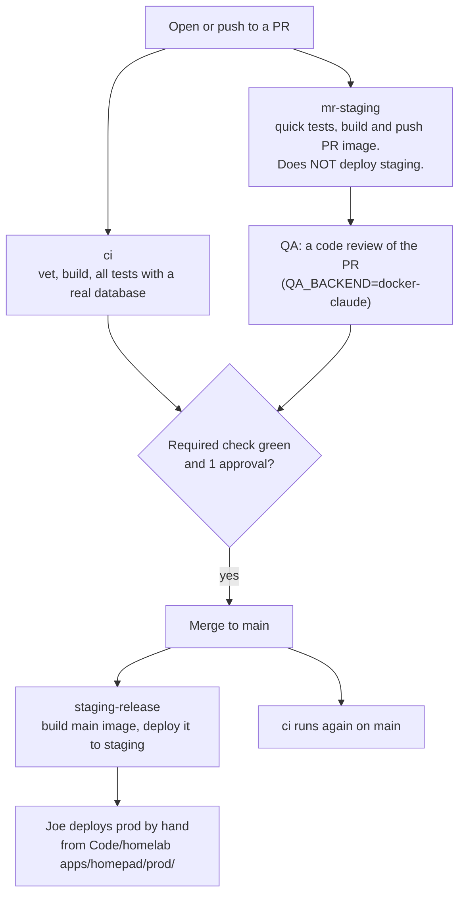

# What the Gitea Actions workflows in this repo do

This page explains every workflow in this folder in plain English, so you don't
have to read the YAML. Gitea only runs the `.yml` files here; it ignores this
README.

A few words used below:

- **Workflow**: one `.yml` file. Gitea runs it automatically when its trigger happens.
- **PR**: a pull request into `main`.
- **Image**: the packaged API server (a container) that the cluster runs. Images
  live in the homelab container registry. Each image has one or more **tags**
  (labels such as `abc1234-test`).
- **Staging**: the test copy of homepad on the homelab staging cluster, in the
  `homepad-staging` namespace (a namespace is a named folder inside the cluster).
  The web app (from the `homepad` repo) and this API both run there.
- **Prod**: the real homepad everyone uses.
- **Required check**: a check that must be green before Gitea lets a PR merge.
- **ci-shared**: a shared repo (`Code/ci-shared`) holding reusable steps. Two of
  these workflows hand most of their work to it.

## The big picture

This repo has no release (tag) workflow. Prod for the API is also deployed by
Joe by hand, from Code/homelab `apps/homepad/prod/`.

## At a glance

| Workflow | Runs when | Deploys to | Blocks merge? |
|---|---|---|---|
| `ci.yml` (CI) | A PR is opened or updated, **and** any push to `main` or a `feat/...` branch | Nothing | **Yes**: required check (the PR run) |
| `mr-staging.yml` (PR -> staging gate) | A PR into `main` is opened or updated | **Nothing** (builds and pushes an image only) | Not by itself. The merge needs an approval, and that approval normally comes from the QA this workflow starts |
| `staging-release.yml` (main -> staging release) | Every push to `main` (every merge) | `homepad-staging` (the API only) | No: runs after the merge |

To merge a PR into `main`, Gitea requires: the CI check green on the PR, and one
approval from an allowed approver (the QA bot or the docs-only approver bot).
Approvals are dropped when new commits are pushed.

---

## `ci.yml`: CI

**When it runs:** every time a PR is opened or gets new commits. It **also**
runs on every push to `main` and to any branch named `feat/...`. So a merged PR
gets tested again on `main`.

**What it does:**

- Starts a throwaway PostgreSQL 17 database just for this run. Its name ends in
  `_test`, because the tests wipe tables and refuse to run against any other
  database.
- Runs `go vet` (Go's built-in checker for common mistakes).
- Builds everything (`go build ./...`).
- Runs every test, including the ones that need the database
  (`go test ./... -count=1 -p 1`). `-p 1` runs the test packages one at a time,
  so they don't fight over the shared database.

**What it changes outside the repo:** nothing. It only posts its check. The
database is thrown away when the run ends.

**What it does NOT do:** it doesn't build an image or deploy anything.

**If it fails:** a vet warning, a compile error, or a failing test. If many
database tests fail at once, look at the "postgres" service in the run log; the
database may not have started.

---

## `mr-staging.yml`: PR -> staging gate

**When it runs:** every time a PR into `main` is opened or gets new commits.

**What it does** (most steps come from ci-shared's `mr-staging`):

- If the PR only changes docs (Markdown, text, `docs/`, `specs/`, README,
  CHANGELOG, LICENSE), it skips everything below. No build, no QA. It then
  auto-approves the PR as the `ci-docs-approver` bot, which clears the
  one-approval rule, so a docs-only PR needs no human approval. This workflow
  passes the bot's token (`DOCS_APPROVER_TOKEN`) into the step; without it the
  approve step only logs a warning.
- Runs the quick unit tests only (`go test ./... -count=1 -run ^Test -short`).
  Tests that need a database skip themselves here; `ci.yml` runs those.
- Builds the PR's image and pushes it with two tags: `<short-sha>-test` and
  `<short-sha>`. ("short-sha" is the first 7 characters of the commit id.)
- The deploy step only prints a message. **It does not deploy staging.**
- Starts QA of the PR. Who does the QA depends on the repo variable `QA_BACKEND`
  (see below).

**What it changes outside the repo:**

- **Registry:** pushes `homepad-api:<short-sha>-test` and `homepad-api:<short-sha>`.
- **Staging:** nothing. A PR's API change is never on staging before it merges.
  Staging keeps running `main`'s API, even while a `homepad` web PR is being
  QA'd there.
- **QA**, picked by the `QA_BACKEND` repo variable (today it's `docker-claude`):
  - `docker-claude`: starts a one-off QA job on the cluster. This repo gives no
    staging address, so that job is a **code review of the PR**, not a test of a
    running server. On a pass it approves and squash-merges the PR; on a fail it
    asks for changes.
  - `nats` (the default if the variable is unset): sends a task to the QA bot
    pool instead. On a pass the QA bot approves and merges the PR.
  - Any other value: no QA is started. The run logs an error note but still goes
    green.
  - Either way, QA is only started for the PR's newest commit. Older pushes are
    skipped.

**What it does NOT do:** it does not deploy staging, and this check is not
itself required. A green mr-staging run means the image was built and QA was
asked for. It doesn't mean QA passed.

**If it fails:** a quick unit test failed, or the image build failed (the
Dockerfile or `go build` inside it). A QA dispatch problem never turns the run
red; look for an error note in the "Dispatch QA" step instead.

---

## `staging-release.yml`: main -> staging release

**When it runs:** every push to `main`, which in practice means every merged PR.

**What it does** (from ci-shared's `staging-release`):

- Builds the image from `main` and pushes it with two tags:
  `<short-sha>-beta` and `<short-sha>`.
- Stops with an error if the staging cluster credentials are missing. That way
  a missing credential can't produce a green run that deployed nothing.
- Points the `homepad-api` deployment in `homepad-staging` at the new image and
  waits up to 2 minutes for it to come up.
- No tests and no QA. The PR was already tested and approved before it merged.

**What it changes outside the repo:**

- **Registry:** pushes `homepad-api:<short-sha>-beta` and `homepad-api:<short-sha>`.
- **Staging:** `homepad-staging` now runs `main`'s API. It does not touch the
  web app or any ConfigMap (a ConfigMap is a settings file the cluster stores).
  The web app's nginx settings come from Code/homelab
  `apps/homepad/staging/03-web.yaml` and are applied by the `homepad` repo's
  workflows, not this one.

**What it does NOT do:** it doesn't touch prod.

**If it fails:** the image build broke on `main`, the staging credentials are
missing, or the new API pod didn't become ready within 2 minutes. Look at the
`homepad-api` pod's logs in `homepad-staging`; a crash on start often means a
config or database problem. `main` is fine, but staging may still be running
the previous API build.
